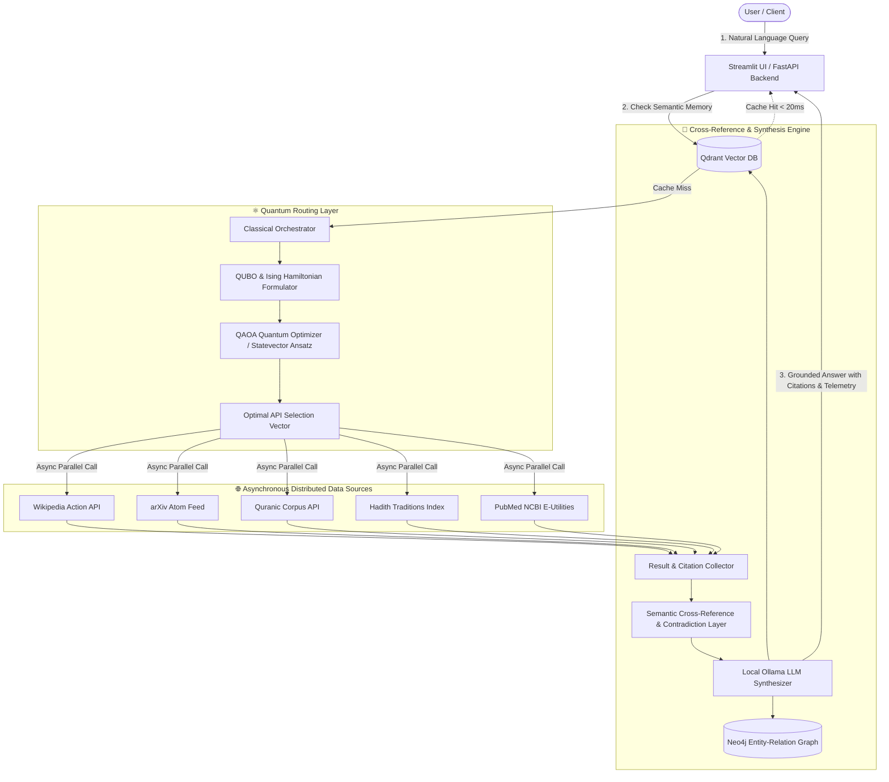

# ⚛️ Quantum Knowledge Weaver (QKW)

[](https://opensource.org/licenses/MIT)
[](https://www.python.org/)
[](https://fastapi.tiangolo.com/)
[](https://qiskit.org/)
[](https://qdrant.tech/)
[](https://streamlit.io/)

**Quantum Knowledge Weaver (QKW)** is an open-source, hybrid quantum-classical multi-source knowledge orchestration brain. It comprehends complex user inquiries, optimizes API selection via the **Quantum Approximate Optimization Algorithm (QAOA)** mapped to a **QUBO Hamiltonian**, concurrently fetches ground truth from heterogeneous public repositories (**Wikipedia**, **arXiv**, **The Holy Quran**, **Hadith Traditions**, and **PubMed**), cross-references disparate claims for corroboration and contradictions, and synthesizes citation-backed answers using local, open-source LLMs (**Ollama**).

---

## 🏛️ System Architecture



---

## 🔬 Mathematical Formulation: QAOA for API Routing

The API routing problem is formulated as a **Quadratic Unconstrained Binary Optimization (QUBO)** problem.

Given $N$ candidate APIs represented by binary decision variables $x_i \in \{0, 1\}$:
- $x_i = 1$: Query API $i$
- $x_i = 0$: Exclude API $i$

### Cost Hamiltonian $H_C$
$$\min_{x \in \{0, 1\}^N} C(x) = - w_{\text{rel}} \sum_{i=1}^N R_i x_i + w_{\text{lat}} \sum_{i=1}^N L_i x_i + P \left( \sum_{i=1}^N x_i - K \right)^2$$

Where:
- $R_i \in [0, 1]$ is the semantic domain relevance of API $i$ to query keywords.
- $L_i \in [0, 1]$ is normalized historical API latency.
- $K$ is the target API budget constraint (e.g., $K=3$).
- $P$ is the quadratic penalty factor enforcing cardinality.

### Quantum Mapping
Mapping binary variables $x_i = \frac{I - \sigma_z^{(i)}}{2}$ converts the QUBO matrix into an Ising spin Hamiltonian:
$$H_C = \sum_{i} h_i \sigma_z^{(i)} + \sum_{i < j} J_{ij} \sigma_z^{(i)} \sigma_z^{(j)}$$

### QAOA Circuit Ansatz
Starting from an equal superposition state $|+\rangle^{\otimes N} = H^{\otimes N} |0\rangle^{\otimes N}$, the parameterized trial state is evolved over $p$ alternating layers:
$$|\psi(\boldsymbol{\gamma}, \boldsymbol{\beta})\rangle = \prod_{k=1}^p e^{-i \beta_k H_M} e^{-i \gamma_k H_C} |+\rangle^{\otimes N}$$
Where $H_M = \sum_{i=1}^N \sigma_x^{(i)}$ is the transverse mixer Hamiltonian. The variational angles $(\boldsymbol{\gamma}, \boldsymbol{\beta})$ are tuned using classical optimization (Nelder-Mead / COBYLA) to maximize the ground-state projection:
$$\min_{\boldsymbol{\gamma}, \boldsymbol{\beta}} \langle \psi(\boldsymbol{\gamma}, \boldsymbol{\beta}) | H_C | \psi(\boldsymbol{\gamma}, \boldsymbol{\beta}) \rangle$$

---

## 📦 Project Structure

```
d:/AI/
├── backend/
│   ├── apis/                  # Isolated clients for external knowledge sources
│   │   ├── base.py            # Base abstract client with latency tracking
│   │   ├── wikipedia.py       # Wikipedia Action & REST summary client
│   │   ├── arxiv.py           # arXiv Atom XML preprint parser
│   │   ├── quran.py           # Quranic verses & translations (Al-Quran / Quran.com)
│   │   ├── hadith.py          # Prophetic traditions (Bukhari, Muslim, Tirmidhi)
│   │   ├── pubmed.py          # NCBI Entrez E-utilities (esearch + esummary)
│   │   └── registry.py        # Central API registry & metadata
│   ├── quantum/               # Quantum computing algorithms & simulators
│   │   ├── qubo_formulator.py # Mathematical QUBO Hamiltonian builder
│   │   ├── router.py          # QAOA variational optimizer & statevector engine
│   │   ├── grover_search.py   # Grover's algorithm simulator for graph searching
│   │   └── vqe_simulator.py   # Variational Quantum Eigensolver for H2 chemistry
│   ├── orchestrator/          # Concurrency engine & Pydantic models
│   │   ├── engine.py          # Master asynchronous pipeline
│   │   └── models.py          # Request/response contracts & telemetry schemas
│   ├── cross_reference/       # Semantic comparison & contradiction detection
│   │   └── comparator.py      # Cross-referencer & similarity matrix
│   ├── synthesis/             # Anti-hallucination synthesis
│   │   └── synthesizer.py     # Local Ollama (llama3.1 / qwen2.5) grounding
│   ├── memory/                # Persistent & in-memory databases
│   │   ├── qdrant_store.py    # Qdrant semantic vector cache
│   │   └── neo4j_store.py     # Neo4j entity-relation knowledge graph
│   ├── config.py              # Environment configuration & defaults
│   └── main.py                # FastAPI endpoints (/query, /health, /apis, /quantum/route)
├── frontend/
│   └── streamlit_app.py       # Interactive Streamlit UI with quantum telemetry
├── tests/                     # Comprehensive test suite (pytest)
│   ├── test_apis.py           # API client tests
│   ├── test_quantum_router.py # QAOA, QUBO, Grover, and VQE tests
│   ├── test_cross_reference.py# Semantic similarity & contradiction tests
│   └── test_orchestrator.py   # End-to-end integration & cache tests
├── docker-compose.yml         # Containerized services (Qdrant, Neo4j, backend, UI)
├── requirements.txt           # Python dependencies
├── pytest.ini                 # Pytest configuration
└── README.md                  # Project documentation
```

---

## 🚀 Quickstart Guide

### 1. Prerequisites
- Python 3.11, 3.12, or 3.13
- (Optional) [Ollama](https://ollama.com/) for local LLM synthesis:
  ```bash
  ollama run llama3.1
  # or
  ollama run qwen2.5
  ```

### 2. Installation
```bash
# Clone the repository
git clone https://github.com/your-username/quantum-knowledge-weaver.git
cd quantum-knowledge-weaver

# Create and activate virtual environment
python -m venv .venv
# On Windows:
.venv\Scripts\activate
# On Linux/macOS:
source .venv/bin/activate

# Install dependencies
pip install -r requirements.txt
```

### 3. Running the Backend & Frontend

#### Option A: Run Locally in Separate Terminals
```bash
# Terminal 1: Launch FastAPI Backend
uvicorn backend.main:app --host 0.0.0.0 --port 8000 --reload

# Terminal 2: Launch Streamlit Frontend
streamlit run frontend/streamlit_app.py
```

#### Option B: Run with Docker Compose
```bash
docker-compose up --build
```
- FastAPI Docs: `http://localhost:8000/docs`
- Streamlit UI: `http://localhost:8501`
- Neo4j Browser: `http://localhost:7474`
- Qdrant Dashboard: `http://localhost:6333/dashboard`

---

## 🧪 Running Automated Tests

Run the test suite with:
```bash
pytest tests/ -v
```

All 9 test suites validate:
- ✅ Wikipedia, arXiv, and Hadith API fetching and error containment
- ✅ QUBO matrix formulation and eigenvalue costs
- ✅ QAOA quantum statevector routing convergence
- ✅ Grover quadratic search on graph structures
- ✅ VQE molecular ground state calculation for $H_2$
- ✅ Cross-referencing similarity and contradiction detection
- ✅ End-to-end asynchronous pipeline with Qdrant vector caching

---

## 🛰️ API Endpoints Reference

| Method | Endpoint | Description |
|---|---|---|
| `POST` | `/query` | Full hybrid pipeline: QAOA routing $\to$ APIs $\to$ Cross-Reference $\to$ LLM Synthesis |
| `GET` | `/health` | System health, quantum engine status, and database connectivity |
| `GET` | `/apis` | List of registered APIs, latency profiles, and domain tags |
| `POST` | `/quantum/route` | Standalone QAOA routing inspection (qubits, energy, probabilities) |
| `POST` | `/quantum/vqe` | Standalone VQE simulation for molecular ground states |
| `GET` | `/memory/graph` | Entity-relation knowledge graph nodes and edges |

---

## 🗺️ Roadmap & Research Publications

- [x] **Phase 1: Core Hybrid MVP** (5 APIs, QAOA statevector router, cross-reference comparator, Ollama grounding).
- [x] **Phase 2: Memory & Graph Architecture** (Qdrant semantic caching, Neo4j knowledge triples, Grover search demo, VQE simulator).
- [ ] **Phase 3: Hardware Verification on IBM Quantum** (Running QAOA circuits on 127-qubit IBM Eagle/Heron QPUs via `qiskit-ibm-runtime`).
- [ ] **Phase 4: Open Source Release & arXiv Preprint** ("Hybrid Quantum-Classical Multi-Domain API Orchestration via Variational Hamiltonian Optimization").

---

## 📜 License
Distributed under the **MIT License**. See `LICENSE` for details.
